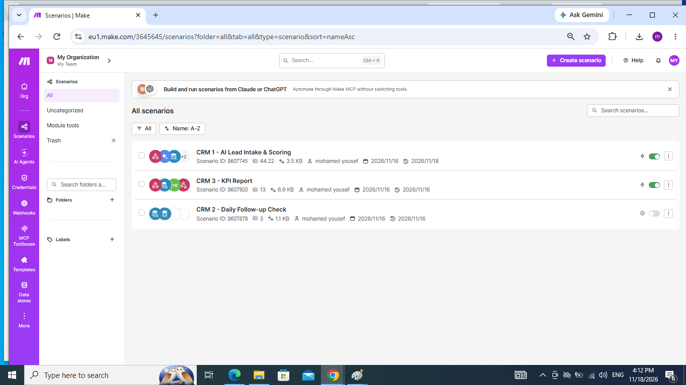
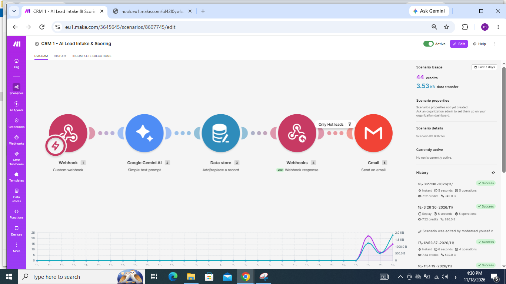
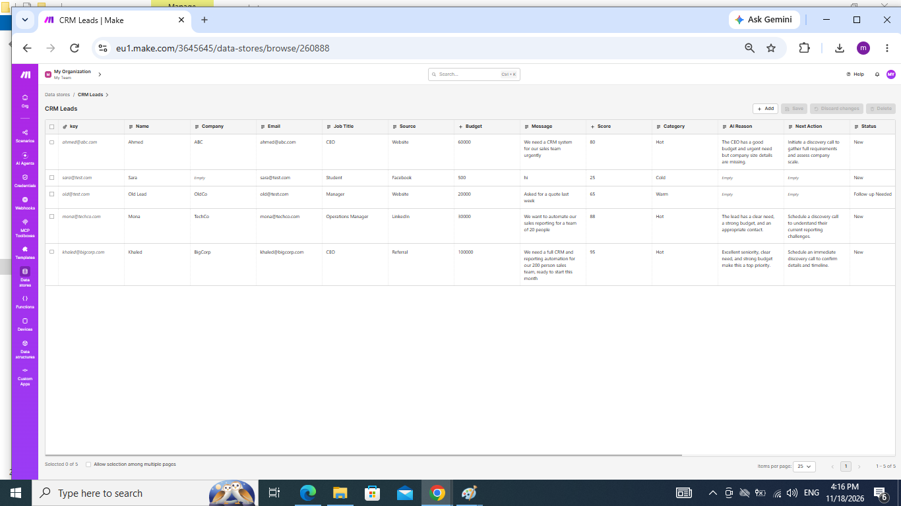
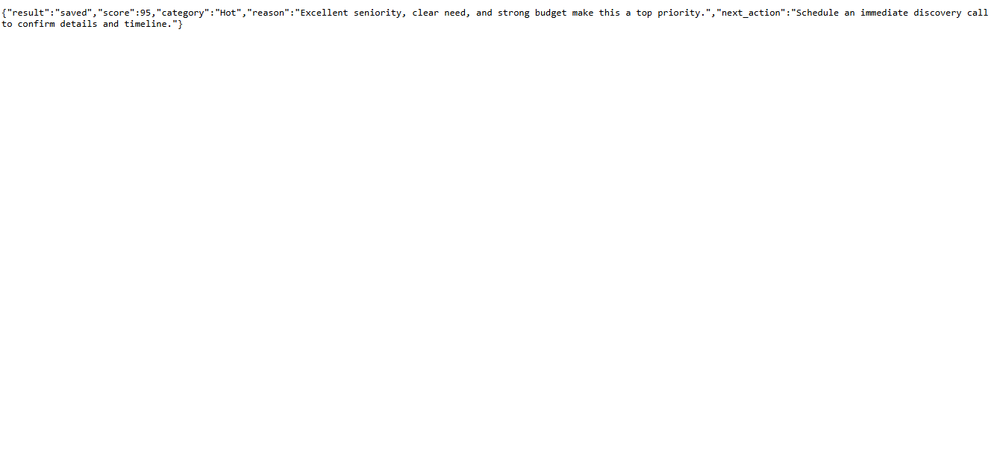
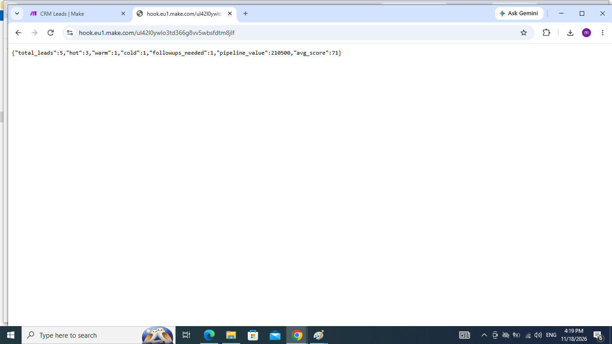

# AI-Powered CRM & Sales Reporting Automation

An end-to-end CRM automation built with **Make.com**. It receives leads from web forms or from free-text messages (WhatsApp / Facebook / email style), scores them with an LLM, alerts sales on Hot leads, flags leads that need follow-up, and produces KPI reports, with no manual work.

**Stack:** Make.com (scenarios, webhooks, data store) · Google Gemini (AI scoring) · JSON over HTTP

---

## What it does

| # | Scenario | Trigger | What happens |
|---|---|---|---|
| 1 | **AI Lead Intake & Scoring** | Webhook (website form or any HTTP call) | Lead data goes to an LLM, which returns a score (0-100), a category (Hot / Warm / Cold), a short reason and a recommended next action. The lead is saved in the CRM and the result is returned in real time. **Hot leads also trigger an instant Gmail alert** to the sales owner. |
| 2 | **Daily Follow-up Check** | Schedule, every day 09:00 | Finds leads with status `New` and no contact for 5+ days, and changes their status to `Follow-up Needed`. |
| 3 | **KPI Report** | Webhook (on demand) | Reads the CRM and returns total leads, Hot/Warm/Cold counts, follow-ups needed, pipeline value and average score as JSON. |
| 4 | **Multi-channel Intake** | Webhook (any channel sends `channel`, `sender`, `text`) | For free-text messages. The LLM extracts name, company, job title and budget from the message, scores the lead, saves it with the phone number or email as the key, and sends a Gmail alert if it is Hot. Built to sit behind WhatsApp / Facebook / email triggers. |

## Screenshots

**1. Scenarios in Make** (screenshot taken before Workflow 4 was added; Workflow 2 is switched off because the free plan allows only two active scenarios)



**2. Workflow 1: webhook, Gemini AI scoring, CRM record, webhook response, and a Gmail alert for Hot leads only**



**3. The CRM data store with AI score, category, reason and next action**



**4. Real-time webhook response returned to the form**



**5. Instant email alert for a Hot lead**


**6. KPI report endpoint**



## Architecture

```
Website form ---------> [Webhook 1] ----+
                                         |
WhatsApp / Facebook /   [Webhook 4] ----+--->  [Gemini AI: extract + score + reason + next action]
email (via a small                                      |---- (Hot only) ---> [Gmail alert]
channel scenario)                                       |
                                              [CRM Data Store]  <--- [Daily follow-up check]
                                                        |
                                              [KPI report endpoint]
```

Each channel needs its own small trigger scenario that forwards `channel`, `sender` and `text` to the multi-channel webhook. The scoring, CRM and alert logic stays in one place.

## CRM data model

`name, company, email, phone, job_title, source, budget, message, score, category, ai_reason, next_action, status, value, owner, created_at, last_contact`

- The record key is the lead's email (web form) or the sender's phone number / email (multi-channel), so a repeated submission updates the same lead instead of creating a duplicate.
- `source` stores the channel (Website, WhatsApp, Email, ...).
- `score`, `budget` and `value` are stored as numbers so the KPI report can calculate on them.
- Hot leads are assigned to `Senior Sales`, all others to `Sales Rep`.

## Example

Request:

```
GET <your-webhook-url>?name=Mona&company=TechCo&email=mona@techco.com
    &job_title=Operations Manager&budget=30000&source=LinkedIn
    &message=We want to automate our sales reporting for a team of 20 people
```

Response:

```json
{
  "result": "saved",
  "score": 88,
  "category": "Hot",
  "reason": "The lead has a clear need, a strong budget, and an appropriate contact.",
  "next_action": "Schedule a discovery call to understand their current reporting challenges."
}
```

Multi-channel request (a WhatsApp-style message, sent to the multi-channel webhook):

```
GET <your-multichannel-webhook-url>?channel=WhatsApp&sender=201001234567
    &text=Hi, I'm Mahmoud from Delta Trading, I'm the CEO. We need a CRM automation for 30 sales reps, budget around 80000, want to start next week
```

The LLM extracts `name: Mahmoud`, `company: Delta Trading`, `job_title: CEO`, `budget: 80000`, scores the lead, and the response is:

```json
{"result":"saved","channel":"WhatsApp","score":92,"category":"Hot"}
```

KPI report response (8 leads in the CRM):

```json
{"total_leads":8,"hot":5,"warm":0,"cold":3,"followups_needed":0,"pipeline_value":350500,"avg_score":62}
```

## AI scoring prompt (simplified)

> You are a B2B sales expert. Evaluate this lead from 0 to 100 based on company size, job title seniority, budget and clarity of the request. Reply with one line only in the format `score|category|reason|next_action`. Hot is 70+, Warm is 40-69, Cold is below 40.

The reply is split on `|` and each part is stored in its own CRM field.

The multi-channel prompt asks the model to also extract the lead details from a free-text message, and to always return exactly 8 fields (using `unknown` / `0` for missing values). Numeric fields are only parsed when the reply has the expected 8 fields, so a vague message such as "how much does it cost?" is saved as a Cold lead instead of breaking the scenario.

## How to deploy it (for a team or client)

1. **Create a Make account** (free plan is enough for a demo), a Data Structure with the CRM fields above (including `phone`) and a Data Store that uses it.
2. **Import the blueprints** from the `blueprints/` folder (use only the ones you need): *Create scenario → ... menu → Import Blueprint*.
3. **Fill the placeholders** in each imported scenario: `<YOUR_WEBHOOK_ID>` (create a Custom Webhook), `<YOUR_DATASTORE_ID>` (pick your Data Store), `<YOUR_GMAIL_CONNECTION_ID>` and `<YOUR_EMAIL>` (connect Gmail and set the sales inbox).
4. **Set the schedule to "Immediately"** on webhook scenarios (an imported scenario defaults to a 15-minute interval, and the webhook response then does not work).
5. **Connect the lead source:** point the website form (or Google Forms / any tool that can call a URL) to the webhook URL. For WhatsApp, Facebook or email, add a small trigger scenario per channel that forwards `channel`, `sender` and `text` to the multi-channel webhook.
6. **Test** with a sample lead, check the CRM record and the Hot-lead email, then switch the scenarios on.

Blueprints are sanitized exports. Module settings may need a quick re-selection after import.

## Positioning

This project is an **automation layer**, not a replacement for a full CRM such as Odoo, HubSpot or Salesforce. In a real company the Data Store would be swapped for the company's CRM, keeping the AI scoring, alerts, follow-up logic and reporting on top of it.

## Limitations and next steps

- This is a working prototype / portfolio project, not a production system: the webhook has no authentication, the Data Store is small, and there is no user interface.
- On Make's free plan only two scenarios can be active at once, so scenarios are switched on as needed. A production setup needs a paid plan.
- The multi-channel scenario was tested by sending WhatsApp-style messages to its webhook. The real WhatsApp (Meta Business account), Facebook Lead Ads and Gmail triggers need the company's own accounts and permissions, and are not connected in this demo.
- Leads' messages are sent to an LLM, so a real deployment needs the company's consent and a data-privacy review.
- Follow-up currently changes the lead status only. Next step: send a Gmail draft to the sales owner for review (human-in-the-loop).
- Next step: a scheduled weekly report sent by email, and a web form in front of the webhook.
- AI scores are a first-pass signal for a salesperson, not a final decision.

## What I learned

- Designing webhook-based automations and handling real data types between modules.
- Prompting an LLM to return a strict, parseable format.
- Debugging scenarios with execution logs and replays (for example, fixing an unsupported function in a scoring formula, and making number parsing safe when the LLM returns an unexpected format).
- Designing one scoring "brain" that many channels can feed, instead of copying the logic per channel.
